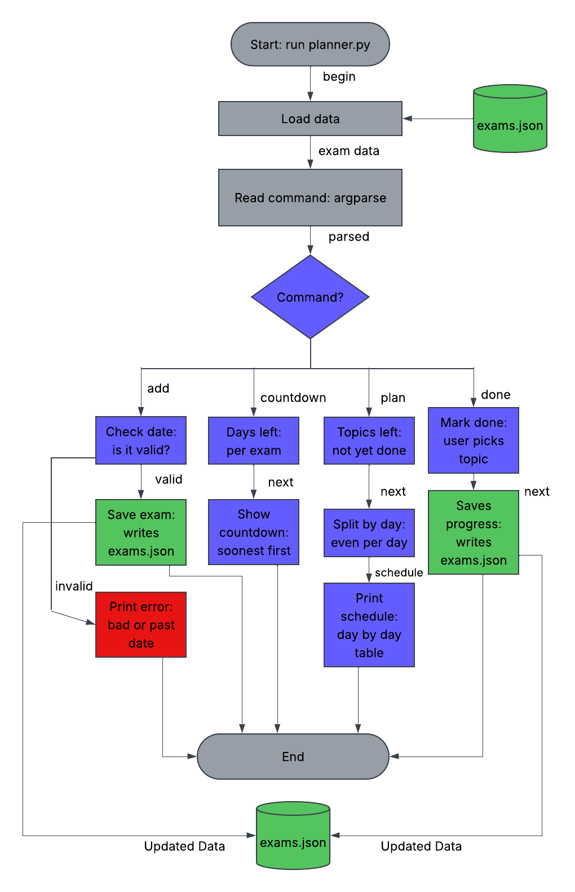

# Study Planner

A Python command line tool that makes a study schedule for my upcoming exams.

## Project Goal
I usually have a few exams close together and end up cramming whatever comes first. This tool lets me enter my exams, their dates, and the topics on each one. It then splits the topics across the days I have left so I cover everything before the test.

## MVP Scope
Version 1.0 will let me:
- Add an exam with a name, date, and topics
- Make a day by day study schedule
- See how many days are left until each exam
- Check off topics I've already studied
- Save everything to a file so it's still there next time

## Future Plans
Things I want to add after the MVP:
- Give harder topics more study days
- Set a max number of study hours per day
- Edit or delete an exam
- Review each topic a second time close to the exam
- Spread out the work when two exams are close together

## Tech Stack
- **Language:** Python 3
- **Libraries:** `datetime`, `json`, `argparse`, `pathlib`, and `tabulate`
- **Data storage:** a local JSON file (`exams.json`)
- **Data sources:** none, since all data is entered by the user
- **Tools:** Cursor, Git, GitHub, and the terminal

## Planned Usage
```bash
python3 src/planner.py add "CS 180 Midterm" 2026-11-12 "Classes,Interfaces,Exceptions"
python3 src/planner.py countdown
python3 src/planner.py plan
python3 src/planner.py done "CS 180 Midterm" "Classes"
```

## Design
- [Eisenhower Matrix](docs/eisenhower-matrix.pdf)
- [Diagram Source File](docs/diagram-source-file.vsdx)
- System Diagram:

